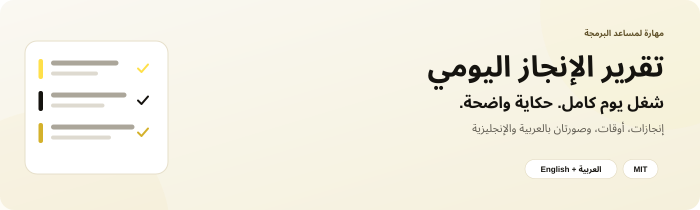
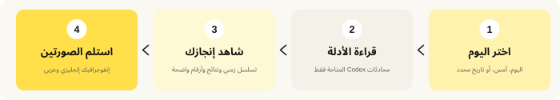
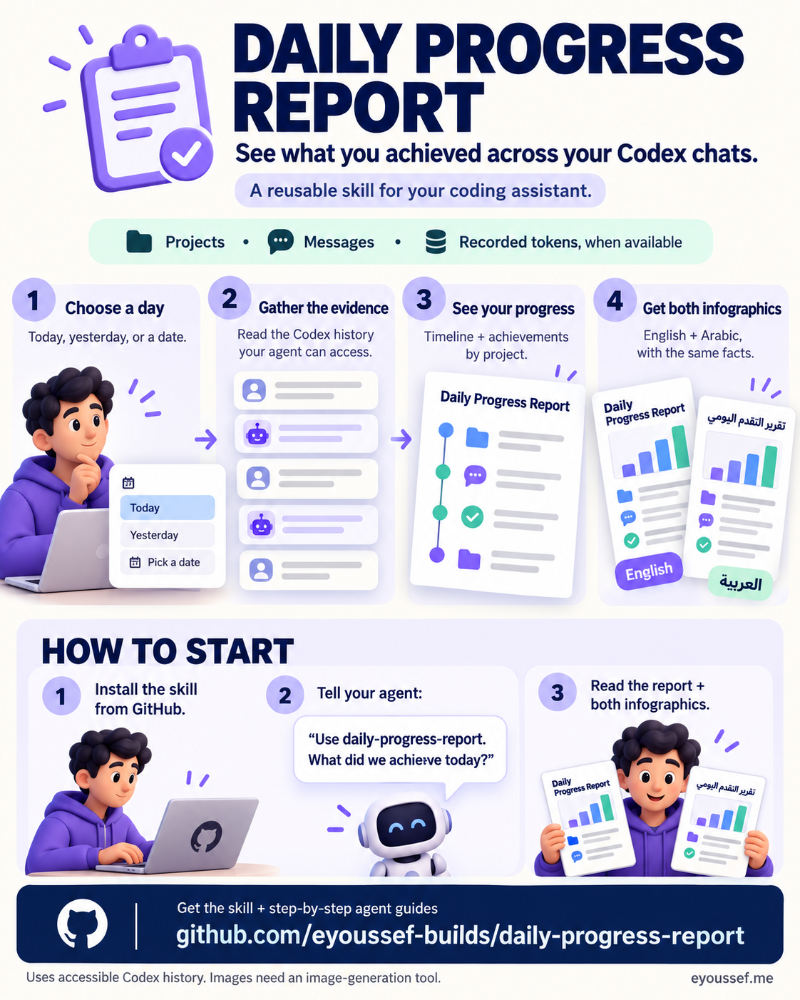
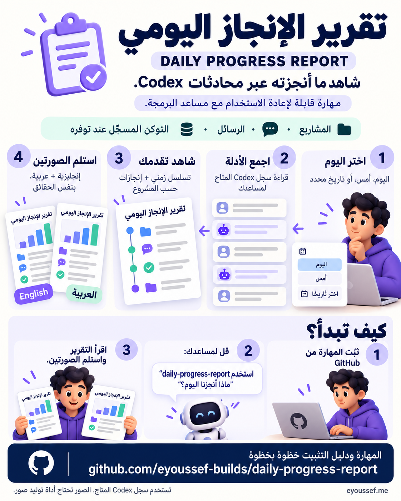

<div dir="rtl">

<p align="center">
  
</p>

<p align="center"><a href="README.md"><b>Read this guide in English</b></a> · <a href="#installation">التثبيت</a> · <a href="#first-use">جرّبها</a> · <a href="#questions">أسئلة وأجوبة</a> · <a href="#share">شاركها</a></p>

<p align="center">
  <a href="LICENSE"></a>
  <a href="docs/agent-installation.ar.md"></a>
  
</p>

---

## 👋 ما هي Daily Progress Report؟

قضيت يومك تتنقّل بين مشاريع وتطلب من مساعدك البحث والكتابة والبناء والإصلاح والمونتاج. وفي آخر اليوم يصبح العمل موزّعًا على محادثات، ويصعب تذكّر **ما الذي تقدّم فعلًا**.

**Daily Progress Report تجمع حكاية يومك في مكان واحد.**

1. **تختار اليوم**: اليوم، أو أمس، أو تاريخًا معينًا.
2. **يقرأ المساعد محادثات Codex المتاحة له** ويتحقق من التقدم المسجّل.
3. تحصل على **تقرير واضح** ثم **صورتين إنفوجرافيك بالإنجليزية والعربية** تعرضان الإنجازات.

<p align="center"></p>

هي لكل من يعمل عبر عدة محادثات Codex: مطوّر مستقل، أو صانع محتوى، أو شخص ينجز أنواع مهام مختلفة داخل مشروع واحد. ترى البحث والكتابة والتصميم والكود والمونتاج معًا.

### ماذا تحصل عليه؟

| الجزء | ماذا ترى؟ |
| --- | --- |
| 🕒 **التسلسل الزمني** | أهم المحطات بترتيب حدوثها مع الأوقات المحلية. |
| ✅ **الإنجازات** | ما بُحث أو كُتب أو صُمم أو عُدّل أو بُني أو نُشر، حسب المشروع. |
| 🧵 **مسارات العمل** | كيف تقدّمت أنواع العمل المختلفة خلال اليوم. |
| 📊 **اليوم بالأرقام** | أعداد موثوقة للمشاريع والمحادثات والرسائل الظاهرة والتوكن المسجّل عند توفره. |
| 🖼️ **صورتان إنفوجرافيك** | نسختان إنجليزية وعربية تعرضان الإنجازات وحجم العمل. |
| 📝 **ما لم يكتمل** | الأعمال المهمة غير المنتهية في التقرير المكتوب فقط، خارج الصورتين. |
| 🔎 **المصادر والتغطية** | روابط مفيدة وشرح واضح للسجلات التي أمكن الوصول إليها. |

تُظهر الصور شخصًا واحدًا يوجّه مسارات عمل مختلفة عبر مركز ذكاء اصطناعي، مع مخرجات واضحة وشريط أرقام مقروء. يتغيّر عدد المسارات حسب اليوم الفعلي.

---

<a id="installation"></a>

## 📥 التثبيت — خطوة بخطوة

**تحتاج إلى:** مساعد يستطيع قراءة سجل Codex المطلوب تلخيصه. الجلسة المحلية مع صلاحية الملفات تكون غالبًا أبسط اختيار للسجلات المحلية. وتحتاج الصورتان **أداة لتوليد الصور**.

### أسهل طريقة: دع مساعدك يثبّتها

1. **افتح مساعد البرمجة** في جلسة تسمح بتنزيل الملفات وحفظها.
2. **انسخ وأرسل هذه الرسالة:**

   ```text
   ثبّت daily-progress-report من
   https://github.com/eyoussef-builds/daily-progress-report.
   اقرأ دليل التثبيت وافحص المهارة وبرامجها أولًا. ثبّت skills/daily-progress-report
   في مكان المهارات الشخصية المدعوم لهذا المساعد. حافظ على أي نسخة معدّلة موجودة.
   أخبرني عندما تصبح جاهزة وكيف أستخدمها.
   ```

3. **اقرأ أي طلب إذن للتنزيل أو حفظ الملفات.** يحتاج المساعد السماح بحفظ المهارة.
4. **تأكد أنها جاهزة.** اسأل: «هل ترى daily-progress-report؟ وأي سجل Codex تستطيع قراءته؟».

🎉 **تم التثبيت؟ جرّب [تقريرك الأول](#first-use).**

### تفضّل نسخ المجلد بنفسك؟

1. **[حمّل ملف ZIP](https://github.com/eyoussef-builds/daily-progress-report/archive/refs/heads/main.zip).**
2. **فك الضغط.** على الماك انقر مرتين. على Windows انقر بالزر الأيمن ثم **Extract All…**.
3. افتح المجلد الناتج ثم **skills**، وستجد **daily-progress-report**.
4. انسخ **المجلد كاملًا** ببرامجه ومراجعه إلى المكان الموجود في [دليل مساعدك](docs/agent-installation.ar.md).
5. أعد فتح المساعد أو تحميل المهارات عند الحاجة، ثم اطلب استخدام **daily-progress-report**.

يغطي الدليل **15 مساعدًا** مع تعليمات macOS وLinux وWindows. يمكن للمساعدين الآخرين اتباع الخطوات إذا كان لديهم وصول مسموح إلى سجل Codex؛ التثبيت لا يضيف قارئًا لسجل كل مساعد الخاص به.

---

<a id="first-use"></a>

## 🚀 تقريرك الأول

### 1. اسأل عن يومك

في **Codex** أرسل:

```text
استخدم $daily-progress-report. ماذا أنجزنا أمس عبر محادثات Codex
التي تستطيع قراءتها؟ استخدم منطقتي الزمنية المحلية.
```

يمكنك أيضًا قول **«ماذا أنجزنا اليوم؟»** أو **«ملخّص اليوم»** أو تحديد تاريخ. في Claude Code استخدم `/daily-progress-report`، وللمساعدين الآخرين طريقة الاستدعاء الخاصة بهم.

### 2. أخبره بالمنطقة الزمنية عند الحاجة

إذا لم يعرفها، أعطه اسمًا مثل `UTC` أو `Europe/London` حتى يُحسب العمل بعد منتصف الليل ضمن اليوم الصحيح. تقرير اليوم يذكر الوقت الذي توقف فيه عن جمع البيانات.

### 3. دعه يقرأ السجل المتاح

يبحث عن نشاط ذلك اليوم عبر المحادثات المتاحة، بما فيها الأرشيف والمحادثات القديمة التي عدت إليها. يجمع المحادثات المرتبطة حسب المشروع الحقيقي ويميّز بين العمل **المطلوب** و**الذي بدأ** و**الذي سُلّم** و**الذي تم التحقق منه**.

> 💡 **قد تكون عدة محادثات مشروعًا واحدًا.** محادثة لكود التطبيق وأخرى لفيديو شرحه لا تعنيان تلقائيًا مشروعين مختلفين.

### 4. اقرأ حكاية اليوم

هذا **مثال خيالي** يوضّح شكل التقرير فقط:

| الوقت | المشروع | التقدم |
| --- | --- | --- |
| 09:10 | تطبيق تخطيط وجبات | انتهى المخطط الأول للمنتج. |
| 11:30 | تطبيق تخطيط وجبات | أُصلحت تجربة قائمة المشتريات. |
| 15:00 | نشرة بريدية | جُهّزت مسودة العدد القادم. |

هنا **مشروعان**. المسودة تظل مسودة، ولا يسميها المساعد رسالة مُرسلة. يستخدم تقريرك الحقيقي الحقائق الموجودة فعلًا ويوفّر روابط للمصادر المهمة.

### 5. استلم الصورتين

ينتهي التقرير بصورتين **منفصلتين مولّدتين**:

| الإنجليزية | العربية |
| --- | --- |
| الإنجازات ومسارات العمل والأرقام الموثوقة بالإنجليزية. | نفس المحتوى بعربية واضحة من اليمين لليسار. |

تحملان **نفس الحقائق والتاريخ والأرقام**. تستخدم العربية أرقام `0–9`. تظل الأعمال غير المكتملة في التقرير المكتوب. وإذا لم تتوفر أداة الصور، تحصل على التقرير المبني على الأدلة مع توضيح الصور التي تعذّر توليدها.

<details>
<summary><b>🔧 ماذا تعني الأرقام؟</b></summary>

- **المشاريع:** المنتجات أو الأنشطة أو الأعمال المترابطة، بعد فهم المحادثات. ليست عدد المجلدات أو المحادثات.
- **الرسائل الظاهرة:** رسائل المستخدم والمساعد بعد حذف التكرار، وتشمل تحديثات التقدم. لا تُحسب الأدوات أو التعليمات الداخلية أو تفكير النموذج، ويُوضّح وجود رسائل آلية.
- **التوكن المسجّل:** أجزاء صغيرة يعالجها النموذج، تُحسب من سجلات استخدام كل استجابة داخل اليوم عند توفرها. إعادة قراءة السياق المخزّن قد تكبّر الإجمالي؛ ليس كلمات جديدة ولا فاتورة.
- الإدخال المخزّن وتوكن التفكير تفاصيل ضمن الإجماليات، وليسا إضافات تُجمع مرة أخرى. البيانات الناقصة تظل غير متاحة أو موضّحة كتغطية جزئية.

لا تثبت هذه الأرقام ساعات العمل أو الساعات الموفّرة أو الدخل أو التكلفة أو درجة إنتاجية.

</details>

---

## 🔒 الخصوصية في دقيقة

- يحتوي المستودع العام **تعليمات وبرامج مساعدة وبيانات اختبار مخترعة**، دون محادثات أو تقارير حقيقية.
- **يقرأ البرنامج المحلي السجل دون تعديله**، ولا يحتوي **كودًا لرفع البيانات عبر الشبكة**.
- يعالج نموذج المساعد الأدلة التي يقرأها، وتعالج خدمة الصور الحقائق الموضوعة في وصف الصورة، وفق إعدادات كل خدمة.
- قد تحتوي الأدلة الخام رسائل ومسارات خاصة. أبقها خارج المستودعات العامة والصور المشتركة.

التفاصيل: [دليل الخصوصية](docs/privacy.ar.md).

---

<a id="questions"></a>

## ❓ أسئلة وأجوبة

<details>
<summary><b>هل تعمل عبر كل أجهزتي؟</b></summary>

تضم السجل الذي تستطيع الأدوات الحالية قراءته فعلًا، وأي نسخة مصدّرة تسمح باستخدامها. تثبيت المهارة لا يربط الأجهزة. يوضّح التقرير ما شمله وما لم يكن متاحًا.

</details>

<details>
<summary><b>هل أستخدمها في Claude أو Cursor أو مساعد آخر؟</b></summary>

يمكن تحميل التعليمات في المساعدين الموضّحين في [دليل التثبيت](docs/agent-installation.ar.md). جمع البيانات يخص سجل Codex، لذلك يحتاج المساعد وصولًا مسموحًا لسجلاته أو أدواته. المستودع لا يتضمن قارئًا لسجل هؤلاء المساعدين الأصلي.

</details>

<details>
<summary><b>هل أحتاج مفتاح API أو خدمة صور مدفوعة؟</b></summary>

برنامج Python المحلي لا يحتاج مفتاح API. يحتاج مساعدك وصوله المعتاد إلى النموذج، وتحتاج الصور أداة توليد متاحة. المهارة لا تضيف الأداة ولا تشتري استخدام API تلقائيًا، وقد تسري تكاليف مقدم الخدمة المعتادة.

</details>

<details>
<summary><b>ماذا لو قال «لم نجد نشاطًا مسجّلًا»؟</b></summary>

هذا يعني أن السجلات المتاحة لم تثبت نشاطًا في التاريخ المحدد. افحص التاريخ والمنطقة الزمنية والمصدر المتاح وتنبيهات جمع البيانات. لا يثبت ذلك أنك لم تعمل.

</details>

<details>
<summary><b>هل أحفظ منطقتي الزمنية المفضلة؟</b></summary>

نعم. أضف تفضيلات خاصة إلى `references/local-profile.md` في المهارة المثبّتة. الملف اختياري وتتجاهله قواعد Git لهذا المستودع. احفظه عند تحديث نسختك.

</details>

<details>
<summary><b>هل ستعمل كل مساء أو ترسل التقرير تلقائيًا؟</b></summary>

تعمل عندما تطلب. طلب التقرير لا ينشئ جدولًا أو ينشر نتائج أو يرسل رسائل لمحادثات أخرى أو يكمل مشاريعها. اطلب هذه الإجراءات منفصلة إذا أردتها.

</details>

<details>
<summary><b>كيف أحدّثها أو أحذفها أو أصلح عدم ظهورها؟</b></summary>

قارن التنزيل الجديد بالنسخة المثبّتة واحفظ التعديلات قبل الاستبدال. للحذف أزل مجلد `daily-progress-report` المثبّت فقط أو استخدم أداة الإزالة في مساعدك. إن لم تظهر، افحص المكان والمجلد الكامل واسم `SKILL.md` ثم أعد التحميل. راجع [حل المشكلات](docs/agent-installation.ar.md#حل-المشكلات).

</details>

<details>
<summary><b>هل أشاركها أو أستخدمها في العمل؟</b></summary>

نعم. يسمح [ترخيص MIT](LICENSE) بالاستخدام والتعديل والمشاركة، بما فيها الاستخدام التجاري، مع إبقاء إشعار الحقوق والترخيص. شارك [رابط المستودع](https://github.com/eyoussef-builds/daily-progress-report)، وراجع بيانات تقريرك الخاص قبل مشاركته.

</details>

---

<a id="share"></a>

## 🖼️ شارك المهارة

صورتان تشرحان ما تفعله المهارة وكيف تبدأ استخدامها، مع رابط GitHub الصحيح.

[تحميل الصورة الإنجليزية](docs/images/infographic-en.png) · [تحميل الصورة العربية](docs/images/infographic-ar.png) · [نصوص جاهزة للمشاركة باللغتين](docs/share.md)

<p align="center">
  <a href="docs/images/infographic-en.png"></a>
  <a href="docs/images/infographic-ar.png"></a>
</p>

---

## 🛠️ للمطوّرين

```text
skills/daily-progress-report/
  SKILL.md       خطوات جمع البيانات وكتابة التقرير
  scripts/       قارئ سجل Codex واختبارات مصطنعة
  references/    التغطية وإرشادات الإنفوجرافيك باللغتين
  assets/        قالب مرن للتقرير
  agents/        بيانات Codex
docs/            التثبيت على 15 مساعدًا والخصوصية، باللغتين
```

<details>
<summary><b>تشغيل برنامج جمع الأدلة أو اختباراته</b></summary>

**تحتاج إلى:** Python 3.9 أو أحدث مع بيانات المناطق الزمنية، وسجلات Codex مسموح بقراءتها، و`zstd` للملفات المضغوطة. يستخدم البرنامج مكتبة Python القياسية؛ تحتاج بعض الأنظمة تثبيت بيانات المناطق الزمنية منفصلة.

من داخل المستودع، غيّر التاريخ والمنطقة الزمنية في المثال:

```sh
python3 -B skills/daily-progress-report/scripts/collect_activity.py --date 2025-01-15 --timezone UTC
```

على Windows استخدم `py -3` إذا كان مشغّل Python لديك. المصدر هو `CODEX_HOME` وإلا `~/.codex`. استخدم `--codex-root` لمصدر آخر مسموح به، أو `--help` للخيارات.

تُحفظ الأدلة في مجلد مؤقت جديد بصلاحيات خاصة، ويشير `index` المطبوع إلى محتواه. **لا تضف الأدلة إلى Git ولا ترفعها.** يختار الوضع العادي الملفات بحسب تحديث الفهرس أو الملف ثم يفحص أوقات الأحداث. استخدم `--full-scan` إذا كانت الأوقات القديمة قد أخفت نشاطًا؛ الأرشيف الكبير قد يستغرق وقتًا أطول.

لتشغيل الاختبارات المصطنعة دون قراءة سجلك:

```sh
python3 -B -m unittest discover -s skills/daily-progress-report/scripts -p 'test_*.py' -v
```

البرنامج يجمع الأدلة؛ يظل على المساعد قراءتها والحكم على الإنجازات. نجاح الاختبارات لا يثبت دقة تقرير يومي معين.

</details>

## 🤝 الدعم والتواصل

لديك سؤال أو اقتراح؟ [افتح بلاغًا](https://github.com/eyoussef-builds/daily-progress-report/issues) بالعربية أو الإنجليزية. للأمور الخاصة راسل **[hello@eyoussef.me](mailto:hello@eyoussef.me)**. استخدم مثالًا مخترعًا عند الإبلاغ عن مشكلة في تنسيق البيانات.

**إعداد [eyoussef-builds](https://github.com/eyoussef-builds)** · ✉️ [hello@eyoussef.me](mailto:hello@eyoussef.me) · 🌐 [eyoussef.me](https://eyoussef.me) · [ترخيص MIT](LICENSE)

</div>
