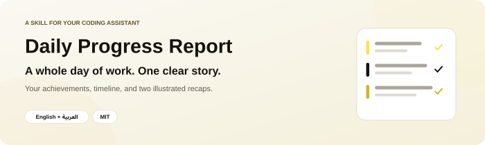
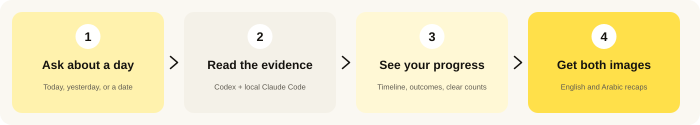

<p align="center">
  
</p>

<p align="center"><a href="README.ar.md"><b>اقرأ هذا الدليل بالعربية</b></a> · <a href="#installation">Install</a> · <a href="#first-use">Try it</a> · <a href="#questions">Questions &amp; answers</a> · <a href="#share">Share</a></p>

<p align="center">
  <a href="LICENSE"></a>
  <a href="docs/agent-installation.md"></a>
  
</p>

---

## 👋 What is Daily Progress Report?

You spent the day moving between projects, asking your AI to research, write, build, fix and edit things. By the evening, the work is scattered across chats—and it is hard to remember **what actually moved forward**.

**Daily Progress Report brings the day back together.**

1. You **ask about a day**: today, yesterday, or a date.
2. The assistant **reads accessible Codex and local Claude Code conversations** and checks the recorded progress.
3. You get **a clear report and Facebook/LinkedIn drafts**, followed by **English and Arabic infographics** showing the achievements.

<p align="center"></p>

It is for anyone whose Codex or Claude Code work spans several conversations: a solo builder, a creator, or someone juggling different tasks in one project. You can see the day's research, writing, design, code and media work together.

### What do you get?

| Part | What you see |
| --- | --- |
| 🕒 **Timeline** | Important milestones in the order they happened, with local timestamps. |
| ✅ **Achievements** | What was researched, written, designed, edited, built or released, grouped by project. |
| 🧵 **Workstreams** | How different kinds of work progressed across the day, labeled Codex or Claude Code. |
| ✍️ **Social drafts** | Ready-to-copy Facebook and LinkedIn posts based on the same achievements. |
| 📊 **Day in numbers** | Verified projects, chats, visible messages and recorded tokens where available. |
| 🖼️ **Two infographics** | Matching English and Arabic images, showing achievements and the day's scale. |
| 📝 **Still open** | Material unfinished work in the written report. It stays out of the infographics. |
| 🔎 **Sources and coverage** | Useful source links and a clear explanation of which history was accessible. |

The images show one person directing several streams of work through an AI hub, with concrete outputs and a readable numbers strip. The number of streams follows the actual day.

---

<a id="installation"></a>

## 📥 Install it — step by step

**You need:** an assistant that can read the Codex and/or local Claude Code history you want summarized. For local Codex records, a local agent session with file access is usually the simplest choice. Both infographics also need an **image-generation tool**.

### The easiest way: let your assistant install it

1. **Open your coding assistant** in a session that can download and save files.
2. **Copy and send this message:**

   ```text
   Install daily-progress-report from
   https://github.com/eyoussef-builds/daily-progress-report.
   Read the installation guide and inspect the skill and helpers first. Install
   skills/daily-progress-report in this agent's supported personal skill directory.
   Preserve any existing customized copy. Tell me when it is ready and how to use it.
   ```

3. **Read any download or file-write permission request.** The assistant needs permission to save the skill.
4. **Check it is ready.** Ask: “Can you see daily-progress-report, and which Codex and Claude Code history can you read?”

🎉 **Installed? Try [your first report](#first-use).**

### Prefer to copy the folder yourself?

1. **[Download the ZIP](https://github.com/eyoussef-builds/daily-progress-report/archive/refs/heads/main.zip).**
2. **Unzip it.** On Mac, double-click it. On Windows, right-click → **Extract All…**.
3. Open the extracted folder → **skills** → find **daily-progress-report**.
4. Copy that **whole folder**, including its scripts and references, to the location in [your agent's guide](docs/agent-installation.md).
5. Reopen or reload the agent if needed, then ask it to use **daily-progress-report**.

The guide covers **15 agents**, with macOS/Linux and Windows instructions. Other agents can follow the workflow when they have authorized access to the supported histories. Native collection supports Codex and local Claude Code; it does not add readers for every other agent.

---

<a id="first-use"></a>

## 🚀 Your first report

### 1. Ask about your day

In **Codex**, send:

```text
Use $daily-progress-report. What have we done yesterday across my accessible
Codex and local Claude Code conversations? Keep source labels and use my local timezone.
```

You can also ask **“what have we done today?”**, **“daily recap”**, or give an exact date. In Claude Code, use `/daily-progress-report`; other agents have their own invocation controls.

### 2. Give the timezone if needed

If the assistant does not know your timezone, tell it—for example `UTC` or `Europe/London`. That keeps late-night work in the right day. A report for today states the time it stopped collecting information.

### 3. Let it read the available history

It looks for that day's activity across accessible Codex and local Claude Code chats, including retained archives and older conversations you returned to. It removes copied fork history and internal reminders, while keeping actual new work. It groups related chats into the actual project and checks the difference between **requested**, **started**, **delivered** and **verified** work.

> 💡 **Several chats can still be one project.** A conversation for an app's code and another for its tutorial video do not automatically mean two separate projects.

### 4. Read the story of the day

Here is a **fictional example**, just to show the shape of a report:

| Time | Project | Progress |
| --- | --- | --- |
| 09:10 | Meal-planning app | Finished the first product outline. |
| 11:30 | Meal-planning app | Fixed the shopping-list journey. |
| 15:00 | Newsletter | Prepared the next edition's draft. |

That is **2 projects**. The draft is a draft; the assistant would not call it sent. Your real report uses the facts it actually finds and provides useful source links.

### 5. Get the social drafts and both infographics

Each report includes separate Facebook and LinkedIn drafts. Both start with a day-specific, grounded reflection on working with AI, then concrete achievements. The default Arabic LinkedIn direction uses repeated ⬅️ arrows and few other emojis. Configure your own voice and CTA in a private local profile. The skill's first-launch introduction is not repeated every day. Drafts are not published or scheduled automatically.

The report ends with two **separate generated images**:

| English | العربية |
| --- | --- |
| Achievements, workstreams and verified counts. | نفس الإنجازات ومسارات العمل والأرقام، بعربية مقروءة من اليمين لليسار. |

Both use the **same facts, date and numbers**. Arabic uses Western digits `0–9`. Unfinished work stays in the written report. If image generation is unavailable, you still get the factual report and a clear note about the missing images.

<details>
<summary><b>🔧 What do the numbers mean?</b></summary>

- **Projects** are actual products, businesses or coherent efforts, grouped by reading the chats. They are not a count of folders or conversations.
- **Visible messages** are deduplicated user-side and assistant messages, including progress updates. Tools, internal instructions and model reasoning are excluded; automated entries are disclosed.
- **Recorded tokens** are small chunks processed by the model, counted from dated per-response records where present. Re-reading cached context can make this total large. It is not newly written words or a bill.
- Keep provider breakdowns: Codex cached input/reasoning are subsets of its totals. Claude cache-read/cache-creation input is separate from uncached input and is normalized once before combining totals. Missing usage stays unavailable or clearly labeled as partial.

These counts do not establish hours worked, hours saved, earnings, billing cost or a productivity score.

</details>

---

## Which conversations can it read?

| Source | What is supported | What is not implied |
| --- | --- | --- |
| Codex | Accessible app tools plus retained local session/archive logs. | Access to every connected or offline device. |
| Claude Code | Retained local project JSONL from CLI/desktop Code sessions; optional desktop session titles. | Ordinary claude.ai chats, Cowork/cloud-only sessions or deleted history. |
| Other/cloud sources | Separately authorized readable connectors, UI or exports, when actually inspected. | A universal Claude account export or automatic pairing. |

The combined collector checks both local sources by default. If one is missing, the report uses the available evidence and states the gap. A project worked on in both tools counts once; each milestone keeps its agent label. Messages and usage also retain per-agent breakdowns.

Claude defaults to `CLAUDE_CONFIG_DIR/projects`, otherwise `~/.claude/projects`. [Anthropic documents the configuration root](https://code.claude.com/docs/en/env-vars) and [local versus cloud desktop sessions](https://code.claude.com/docs/en/desktop). The specific transcript fields are observed formats, not a guaranteed public API. [Detailed source and accounting rules](skills/daily-progress-report/references/claude-source.md).

---

## 🔒 Privacy in one minute

- This public repository contains **instructions, helper code and invented test data**. No real conversations or reports are included.
- The local collector **reads history without modifying it** and has **no network-upload code**.
- Your agent's model processes the evidence it reads; an image service processes the highlight facts in its prompt. Their own data settings apply.
- Raw evidence can contain private messages and paths. Keep it out of public repos and shared images.

Full details: [Privacy guide](docs/privacy.md).

---

<a id="questions"></a>

## ❓ Questions & answers

<details>
<summary><b>Does it work across all my devices?</b></summary>

It includes history the current tools can actually read, plus any authorized export you supply. Installing a skill does not connect other devices. The report says what was covered and what was unavailable.

</details>

<details>
<summary><b>Can I use it in Claude, Cursor or another agent?</b></summary>

The instructions can be loaded in the agents covered by the [installation guide](docs/agent-installation.md). Native collectors cover Codex and local Claude Code history. The running assistant needs authorized file/tool access; it cannot automatically read other agents, cloud-only sessions or every device.

</details>

<details>
<summary><b>Do I need an API key or a paid image service?</b></summary>

The local Python helper does not need an API key. Your assistant needs its own model access, and images need an available generation tool. The skill does not add that tool or silently purchase API usage. Your provider's normal charges may apply.

</details>

<details>
<summary><b>What if it says “no recorded activity found”?</b></summary>

That means the available records did not establish activity for that date. Check the date, timezone, accessible source and collection warnings. It does not prove you did no work.

</details>

<details>
<summary><b>Can I set my preferred timezone?</b></summary>

Yes. Add private defaults to `references/local-profile.md` in your installed skill. The file is optional and ignored by this repository's Git rules. Preserve it when updating your copy.

</details>

<details>
<summary><b>Will it run every evening or send the report somewhere?</b></summary>

It runs when you ask. A recap request does not create a schedule, publish a report, message other chats or continue their projects. Request those actions separately if you want them.

</details>

<details>
<summary><b>How do I update, uninstall or fix discovery?</b></summary>

Compare a new download with your installed copy and preserve local changes before replacing it. To uninstall, remove only the installed `daily-progress-report` folder or use your agent's uninstall control. If it does not appear, check the directory, full folder structure and `SKILL.md` filename, then reload. See [troubleshooting](docs/agent-installation.md#troubleshooting).

</details>

<details>
<summary><b>Can I share it or use it for work?</b></summary>

Yes. The [MIT license](LICENSE) permits use, modification and sharing, including commercial use, with the copyright/license notice retained. Share [the repository link](https://github.com/eyoussef-builds/daily-progress-report); review your own private report before sharing it.

</details>

---

<a id="share"></a>

## 🖼️ Share this skill

Two infographics explain what the skill does and how to start, with its GitHub link included.

[English image](docs/images/infographic-en.png) · [Arabic image](docs/images/infographic-ar.png) · [Copyable bilingual captions](docs/share.md)

<p align="center">
  <a href="docs/images/infographic-en.png"></a>
  <a href="docs/images/infographic-ar.png"></a>
</p>

---

## 🛠️ For developers

```text
skills/daily-progress-report/
  SKILL.md       Collection and reporting workflow
  scripts/       Combined entrypoint, Codex/Claude Code adapters and synthetic tests
  references/    Source attribution, social drafts and bilingual infographic guidance
  assets/        Flexible report template
  agents/        Codex metadata
docs/            Installation for 15 agents and privacy guides, in both languages
```

<details>
<summary><b>Run the local collector or its tests</b></summary>

**Needs:** Python 3.9+ with timezone data, readable authorized Codex and/or Claude Code logs, and `zstd` for compressed Codex `.zst` files. The helper uses Python's standard library. Some platforms need timezone data installed separately.

From this repository, replace the example date and zone with yours:

```sh
python3 -B skills/daily-progress-report/scripts/collect_daily.py --date 2025-01-15 --timezone UTC
```

On Windows, use `py -3` if that is your Python launcher. Codex defaults to `CODEX_HOME` or `~/.codex`; Claude Code defaults to `CLAUDE_CONFIG_DIR` or `~/.claude`. Use `--codex-root` / `--claude-root` for authorized exports, or `--sources codex` / `--sources claude_code` for one source. `collect_activity.py` remains available as a Codex-only entrypoint. Use `--help` for all options.

Output goes to a new private temporary evidence folder. The printed `index` points to combined coverage and separate source evidence. No raw messages are printed by the CLI. **Do not commit or upload that evidence.** Normal mode selects candidates by index/file update time and then filters actual event timestamps. Use `--full-scan` when stale timestamps could hide activity; large archives can take longer.

Run the synthetic fixtures without reading your history:

```sh
python3 -B -m unittest discover -s skills/daily-progress-report/scripts -p 'test_*.py' -v
```

The helper collects evidence; the agent must still read it and judge accomplishments. Passing tests is not proof that a particular daily report is correct.

</details>

## 🤝 Support & contact

Questions or ideas? [Open an issue](https://github.com/eyoussef-builds/daily-progress-report/issues) in English or Arabic. For private matters, email **[hello@eyoussef.me](mailto:hello@eyoussef.me)**. Use an invented example when reporting a data-format problem.

**Created by [eyoussef-builds](https://github.com/eyoussef-builds)** · ✉️ [hello@eyoussef.me](mailto:hello@eyoussef.me) · 🌐 [eyoussef.me](https://eyoussef.me) · [MIT license](LICENSE)
